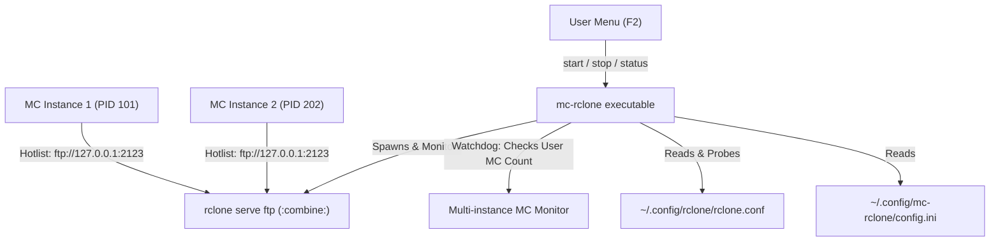

# Design Specification: mc-rclone Refactor, XDG Configuration, and VFS Cache Integration

**Date:** 2026-10-22  
**Author:** Pair Programming Session  
**Status:** Approved  
**Target Repository:** `/Users/michele/PycharmProjects/mc-rclone`

---

## 1. Executive Summary

`mc-rclone` provides seamless on-demand cloud storage integration for GNU Midnight Commander (`mc`) using `rclone serve ftp` with the `:combine:` backend.

This design covers:
1. **Repository Cleanup:** Removing deprecated ExtFS experimentation scripts (`mc-rclone` old ExtFS, `rclone+`, `mc.menu.snippet`) and consolidating the core bridge into a single executable named `mc-rclone`.
2. **XDG Configuration & VFS Cache Integration:** Introducing `~/.config/mc-rclone/config.ini` with English comments and sensible defaults for Rclone VFS cache (`writes` mode, cache max size, cache max age, directory cache time, FTP bind address, and port).
3. **Multi-Instance MC Watchdog:** Enhancing process lifecycle monitoring to support multiple simultaneous `mc` tabs/windows; the local FTP bridge remains active as long as any user `mc` instance is running, cleanly terminating only when the final `mc` instance exits.
4. **Clean Installation & Comprehensive Test Suite:** Updating `install.sh`, `uninstall.sh`, and `tests/` with full regression coverage.

---

## 2. Architecture & Components



### 2.1 File & Repository Layout

```text
mc-rclone/
├── LICENSE
├── README.md
├── install.sh                  # Portable installer (config, menu, hotlist, binary)
├── uninstall.sh                # Clean uninstaller (reverts MC config to original state)
├── mc-rclone                   # Unified Python 3 stdlib executable (zero pip dependencies)
├── docs/
│   ├── specs/                  # Technical design documents
│   └── plans/                  # Implementation plans
└── tests/
    ├── test_bridge.py          # Pytest unit tests (config, probe, args, watchdog)
    └── test_install.sh         # Isolated installer verification script
```

**Removed Obsolete Files:**
- `mc-rclone` (16 KB ExtFS script) -> Replaced by renamed bridge script.
- `rclone+` (13 KB ExtFS helper) -> Removed.
- `mc.menu.snippet` -> Removed.

---

## 3. Configuration Specification (`config.ini`)

Location: `$XDG_CONFIG_HOME/mc-rclone/config.ini` (defaults to `~/.config/mc-rclone/config.ini`).

### 3.1 Content & Default Values (English Comments)

```ini
[server]
# Local IP address to bind the FTP server (loopback for security)
bind_address = 127.0.0.1

# Local FTP port used by rclone and configured in Midnight Commander hotlist
port = 2123

[vfs]
# VFS cache mode: off | minimal | writes | full
# - writes: Modified or copied files are buffered locally and uploaded in background (recommended for MC)
# - full: Caches both reads and writes; enables random seeking for large media/archive files
cache_mode = writes

# Maximum size of local VFS disk cache (e.g. 5G, 10G, 50G, off)
cache_max_size = 10G

# Maximum age of cached files before automatic eviction (e.g. 24h, 7d)
cache_max_age = 24h

# Directory listing cache duration (instant directory navigation without repeated API calls)
dir_cache_time = 5m

[network]
# Socket connection timeout in seconds for probing SFTP/SSH remotes
# Unreachable or offline remotes are automatically skipped to prevent rclone hangs
sftp_probe_timeout = 0.2
```

### 3.2 Resilience Rules
- If `config.ini` does not exist when `mc-rclone` runs, it auto-generates the file with default values and comments.
- If individual keys or sections are missing from `config.ini`, the script falls back gracefully to internal defaults.
- Re-running `install.sh` never overwrites an existing user `config.ini`.

---

## 4. Execution & Process Lifecycle

### 4.1 Remote Discovery and SFTP Health Probe
1. Parses `~/.config/rclone/rclone.conf` using Python's `configparser`.
2. Inspects remote types.
3. For SFTP remotes, performs a quick non-blocking socket test (`socket.create_connection((host, port), timeout=sftp_probe_timeout)`).
4. Unreachable hosts are logged and excluded from the upstreams list.
5. Assembles `:combine:` parameter: `remote1=remote1: remote2=remote2: ...`

### 4.2 Spawning Rclone Server
Spawns:
```bash
rclone serve ftp \
  --addr "{bind_address}:{port}" \
  --vfs-cache-mode "{cache_mode}" \
  --vfs-cache-max-size "{cache_max_size}" \
  --vfs-cache-max-age "{cache_max_age}" \
  --dir-cache-time "{dir_cache_time}" \
  --combine-upstreams "{upstreams}" \
  :combine:
```

### 4.3 Multi-Instance MC Watchdog
- When `mc-rclone start` is called:
  - If server is already running on `bind_address:port`, it reports `Server already running on port <port> (PID <pid>)` and exits 0.
  - If not running, launches the server process in the background.
  - Spawns a lightweight watchdog loop (checking every 2 seconds).
- Multi-instance rule:
  - The watchdog checks for active `mc` processes owned by the user (`ps -u <USER> -o comm=` matching `mc` or `mc.real`).
  - As long as count >= 1, the bridge remains running.
  - When count == 0, the server process is sent `SIGTERM`, temporary PID files are unlinked, and the watchdog exits.
- Manual stop:
  - `mc-rclone stop` sends `SIGTERM` to the server PID and cleans up PID files immediately.

---

## 5. Midnight Commander Integration

### 5.1 User Menu (`~/.config/mc/menu`)
Appends or updates:
```text
+ ! t t
R   Start Cloud Storage Server (Rclone)
    ~/.local/share/mc/scripts/mc-rclone start

S   Stop Cloud Storage Server (Rclone)
    ~/.local/share/mc/scripts/mc-rclone stop

?   Cloud Storage Status (Rclone)
    ~/.local/share/mc/scripts/mc-rclone status
```

### 5.2 Directory Hotlist (`~/.config/mc/hotlist`)
Ensures presence of:
```text
ENTRY "Cloud: Rclone (All Remotes)" URL "ftp://127.0.0.1:2123"
```
*(If port is customized in `config.ini`, `install.sh` uses the customized port).*

---

## 6. Verification and Testing

1. **Unit Tests (`tests/test_bridge.py`)**:
   - `test_default_config()`: Default parameters match design when file does not exist.
   - `test_custom_config()`: Custom options in `config.ini` are accurately parsed and applied.
   - `test_sftp_probe_success()` and `test_sftp_probe_failure()`: Offline remotes are filtered.
   - `test_command_line_generation()`: All VFS flags (`--vfs-cache-mode`, `--vfs-cache-max-size`, etc.) are correctly formatted in Rclone command.
   - `test_multi_instance_watchdog_logic()`: Server survives when 1 of 2 MC instances terminates, stops when 0 instances remain.
2. **Installation Tests (`tests/test_install.sh`)**:
   - Runs in isolated temporary `HOME` directory.
   - Verifies binary copy, config template creation, menu injection, hotlist injection.
   - Verifies complete reversal upon `uninstall.sh`.
